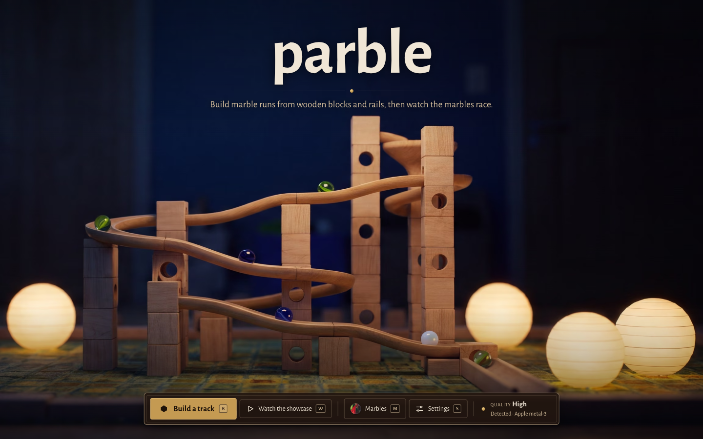
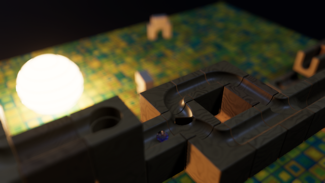
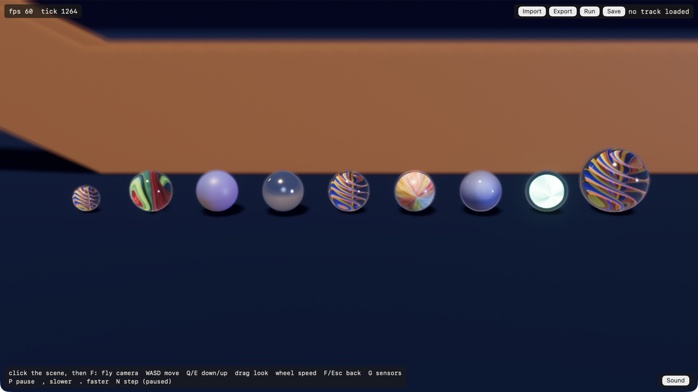
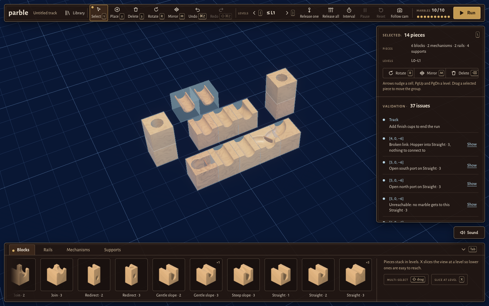

# parble

A browser 3D wooden marble-run sandbox: build tracks from carved wooden blocks, rails and mechanisms on a 3D snap grid, drop glass marbles, and watch a cinematic camera follow the run through a night playroom.

Play: https://parble.pardev.net



[](https://github.com/paulrobello/parble/actions/workflows/ci.yml)
[](https://github.com/paulrobello/parble/actions/workflows/deploy.yml)
-blue)


## Table of Contents

* [About](#about)
* [Features](#features)
  * [Building](#building)
  * [Running](#running)
  * [Look and sound](#look-and-sound)
* [Screenshots](#screenshots)
* [Browser support](#browser-support)
* [Controls](#controls)
  * [Editor](#editor)
  * [Camera](#camera)
  * [Playback](#playback)
* [URL flags](#url-flags)
* [Development](#development)
* [Deployment](#deployment)
* [License](#license)

## About

parble is a desktop-browser marble-run sandbox. The whole app is a Rust workspace compiled to wasm32: Bevy renders through WebGPU, and a deterministic Rapier simulation runs at a fixed 240 Hz, so a track gives the same run, down to the same trajectory hash, natively and in every browser. A TypeScript overlay draws the editor, the title screen and settings, and drives a Web Audio engine for the marbles' sound and the music.

[](https://buymeacoffee.com/probello3)

## Features

### Building
- **34 kit pieces**: straights, curves, slopes, drops, towers, joiners, redirects, round rails and S-rails, a funnel, a catch, pillars and end stops, each carved with grain and seams and three levels of detail.
- **Mechanisms**: hopper, finish cups, splitter (Random or Alternate), toggle, one-way gate, one-way trapdoor hole, checkpoint with a glow inlay, rope-curtain arch and stepper lifts that carry marbles back up a layer.
- **Editor**: place, rotate, mirror, delete, multi-select, copy and paste, move groups, drag-to-lay runs of pieces, height slicing and full undo and redo.
- **Live validation**: open ports, broken links and pieces no marble can reach show in a panel with click-to-focus.
- **Marble check**: on demand, the editor runs the release each marble type would make in a headless sim and reports where a type falls off or stalls.
- **Nudge zones**: invisible volumes that keep marbles moving past a weak spot, drawn only in the editor.
- **Library**: tracks save to the browser (IndexedDB) and export or import as versioned `.parble` files, with schema migrations.

### Running
- **Hopper runs**: release one marble, all of them, or one every interval. Pause, step, and slow the run to 0.5, 0.25 or 0.1 speed.
- **Seven marble types** (cat's eye, glazed, steel, swirl, onionskin, opal and glow) in three sizes (mini 10 mm, standard 16 mm and shooter 25 mm), each with its own mass and material.
- **Run director**: a follow camera that frames each marble's path, blends between shots, swings clear of tall pieces, and takes over at camera zones such as a tower drop. A free-fly camera and an orbit camera are a key away.
- **Determinism**: the sim takes no wall-clock input, so export, re-import and run reproduce the identical trajectory hash.

### Look and sound
- **Night playroom**: warm paper lanterns, a lamp and moonlight over a patterned rug, with SSAO, bloom and bokeh depth of field.
- **Glass marbles** with screen-space transmission and inner vanes on High and Ultra, and lighter fallback shaders on Low and Medium.
- **Quality tiers** (Low, Medium, High and Ultra), picked on first run from a short GPU benchmark and changeable in Settings.
- **Audio**: rolling loops driven by speed, impacts driven by force, mechanism sounds, spatialization and voice limits, plus a crossfading music player with build, run and night moods and a mixer.
- **GPU recovery**: a lost WebGPU device rebuilds the renderer instead of ending the session.

## Screenshots

The all-pieces showcase track on the playroom rug (Ultra):



Every marble type on High, in Safari:



The editor:



## Browser support

parble needs WebGPU: current desktop Chrome or Edge, or Safari with WebGPU. There is no WebGL fallback; a browser without WebGPU gets an unsupported page. The performance target is 60 fps (a paced p95 frame time of 16.7 ms or less) at 2560 × 1440 on the High tier on Apple M4-class hardware, with a 2,000-piece scene.

## Controls

On the web, click the scene first so it has keyboard focus. Every editor action also has a visible button.

### Editor

| Key | Action |
|---|---|
| `1` `2` `3` | Select, Place, Delete |
| `R` / `⇧R` | Rotate a quarter turn clockwise / anticlockwise |
| `M` | Mirror |
| `⌘Z` / `⇧⌘Z` | Undo / Redo |
| `[` `]` / `X` | Slice down / up / toggle |
| Arrows, `PgUp` `PgDn` | Nudge the selection |
| `⌫` | Delete the selection |
| `Esc` | Drop the brush, clear the selection, or stop the run |
| `Space` | Run / Pause |
| `Tab` / `\` | Collapse the drawer / the panel |

### Camera

| Input | Action |
|---|---|
| `F` | Free-fly camera on or off (locks the pointer) |
| `C` | Switch between the run director and the orbit camera |
| `W` `A` `S` `D` | Fly forward, left, back, right |
| `E` or `Space`, `Q` or `Shift` | Fly up, down |
| Mouse | Look while flying |
| Wheel | Fly speed |
| `Esc` | Leave fly mode |
| `G` | Mechanism sensor overlay |
| `V` | Camera zone overlay |

### Playback

| Key | Action |
|---|---|
| `P` | Pause or resume |
| `,` / `.` | Slower / faster (1, 0.5, 0.25, 0.1) |
| `N` | While paused, step 1/60 s |

## URL flags

Add these to the URL as query parameters, for example `/?scenario=showcase&quality=ultra&dof=0`. Any query skips the title screen.

| Flag | Effect |
|---|---|
| `scenario=<name>` | Scene to load: `editor`, `showcase`, `allpieces`, `mechanisms`, `playroom`, `lineup`, `closeup`, `stress2000`, `kit2000`, `funnel`, `funnel-rail` or `ramp`. |
| `quality=low\|medium\|high\|ultra` | Graphics tier for this load. |
| `camera=<c>` | `director`, `orbit`, `overview`, or a fixed shot such as `rope-side`. |
| `marble=<type>` | `cats-eye`, `glazed`, `steel`, `swirl`, `onionskin`, `opal` or `glow`. |
| `marble-size=<size>` | `mini`, `standard` or `shooter`. |
| `dof=0\|1`, `bloom=0\|1`, `taa=0\|1` | Override the tier's depth of field, bloom or TAA. |
| `editor-fill=<n>` | Start the editor with an `n`-piece grid (up to 4,000). |
| `time-scale=<s>` | Start at speed `1`, `0.5`, `0.25` or `0.1`. |
| `mute=1` | Silence all audio for the session. |
| `music=<state>` | Pin the music to `title`, `build`, `run` or `night`, or `off`. |
| `title=1` | Show the title screen even with other flags. |

The full list, the native command-line switches and the `window.__parble` automation hook are in [docs/agent-operability.md](docs/agent-operability.md).

## Development

Requires the Rust stable toolchain (pinned by `rust-toolchain.toml`, with the `wasm32-unknown-unknown` target), Trunk, Node 24 and, for the kit and playroom asset builds, Blender.

```bash
make dev             # Trunk dev server on http://127.0.0.1:5310
make build           # cargo build, native and wasm32
make test            # cargo test --workspace
make checkall        # fast gate: fmt, clippy (native + wasm32), Biome/tsc, cargo test, Vitest, audio tests
make checkall-ci     # push gate: actionlint + checkall + wasm32 --locked build + gitleaks + determinism-wasm + web-size
make build-web       # release web build into target/web-dist
make web-e2e         # Playwright suite in GPU Chromium on the 5311 preview (local only)
make shots-test      # native look-dev shots, checked against the drawn state (local only)
make perf-gate       # 1440p High frame-time gate, GPU Chromium and Safari, load-guarded (local only)
make run-shot        # native screenshot to target/shots/run-shot.png
make kit-check       # validate every kit piece against docs/kit-contract.md
```

The workspace crates are `parble-core` (cell grid, ports, pieces, track model), `parble-kit` (piece catalogue and collision sidecars), `parble-sim` (deterministic Rapier sim), `parble-procgen` (procedural tracks), `parble-sim-wasm` (the Node determinism check), `parble-render` (Bevy rendering) and `parble-app` (the app, native and web). `web/ui` holds the TypeScript overlay and the Web Audio engine.

Browser suites run locally on a GPU, never in CI. The product plan is [PRD.md](PRD.md), with per-phase plans in [plans/](plans/), the kit contract in [docs/kit-contract.md](docs/kit-contract.md) and the perf method and results in [docs/perf/](docs/perf/).

## Deployment

`.github/workflows/ci.yml` runs the gate's lint, test, determinism, secret-scan and size checks on every push to `main` and every pull request. When CI succeeds on a push to `main`, `.github/workflows/deploy.yml` rebuilds the web bundle from that exact commit and publishes it to GitHub Pages at https://parble.pardev.net.

## License

MIT, see [LICENSE](LICENSE).
