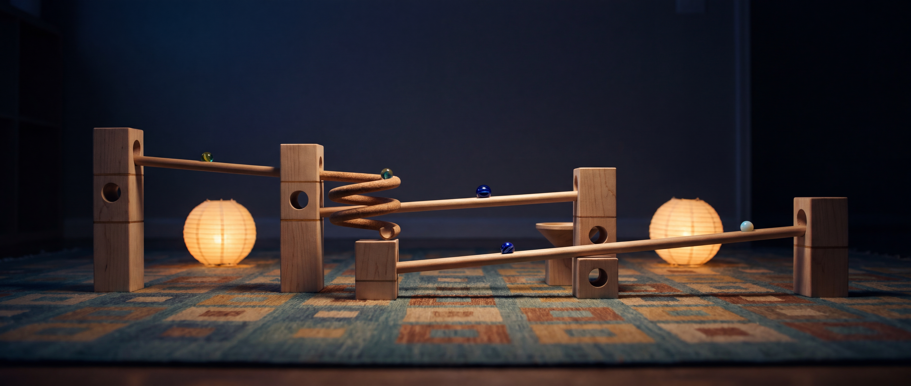
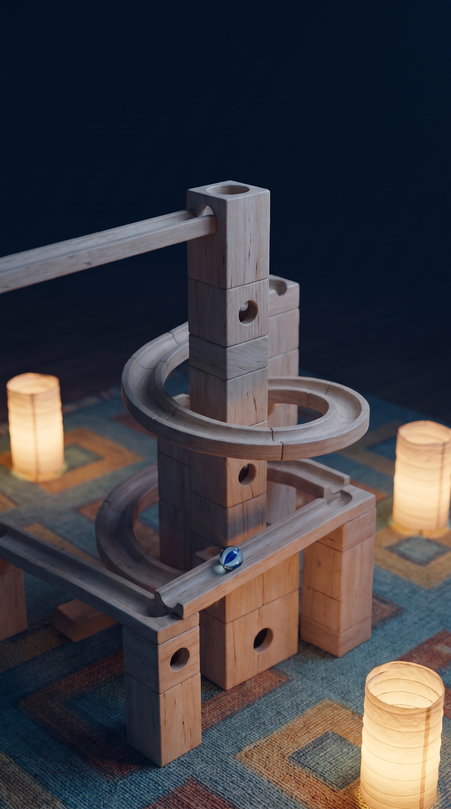
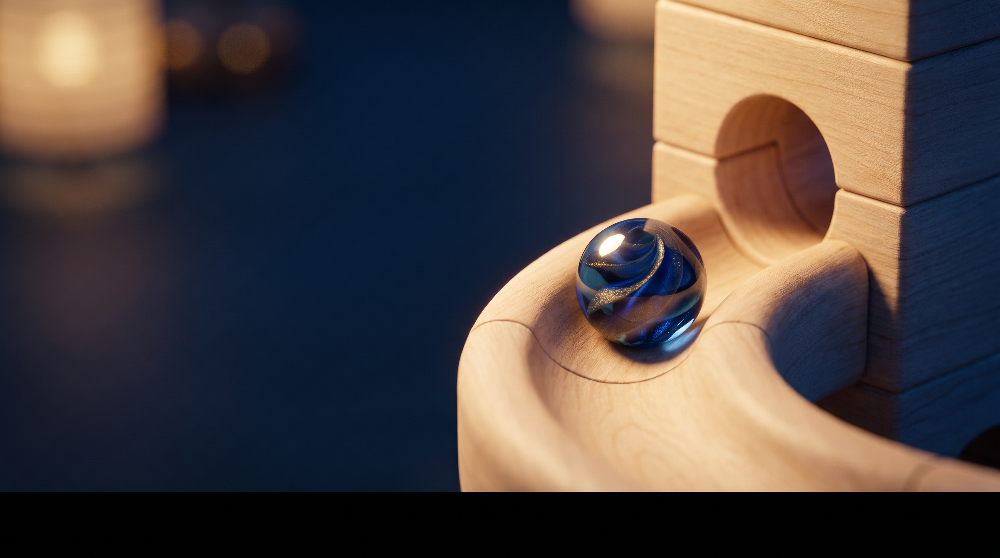
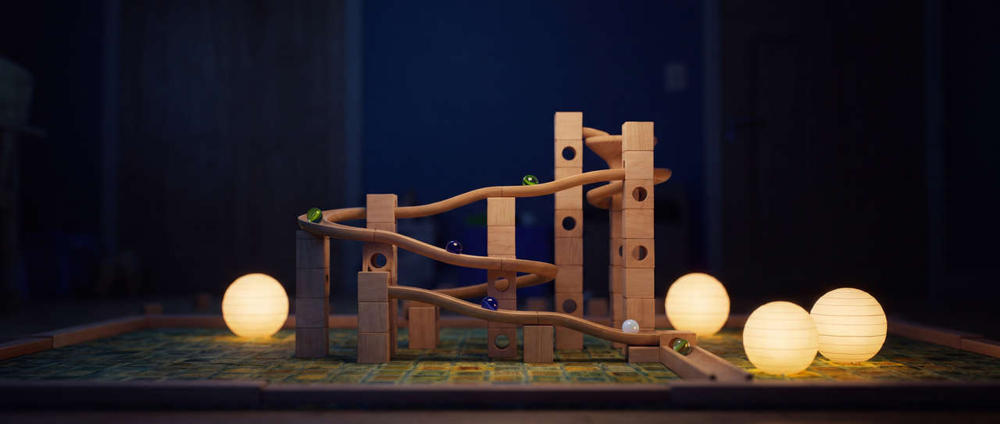
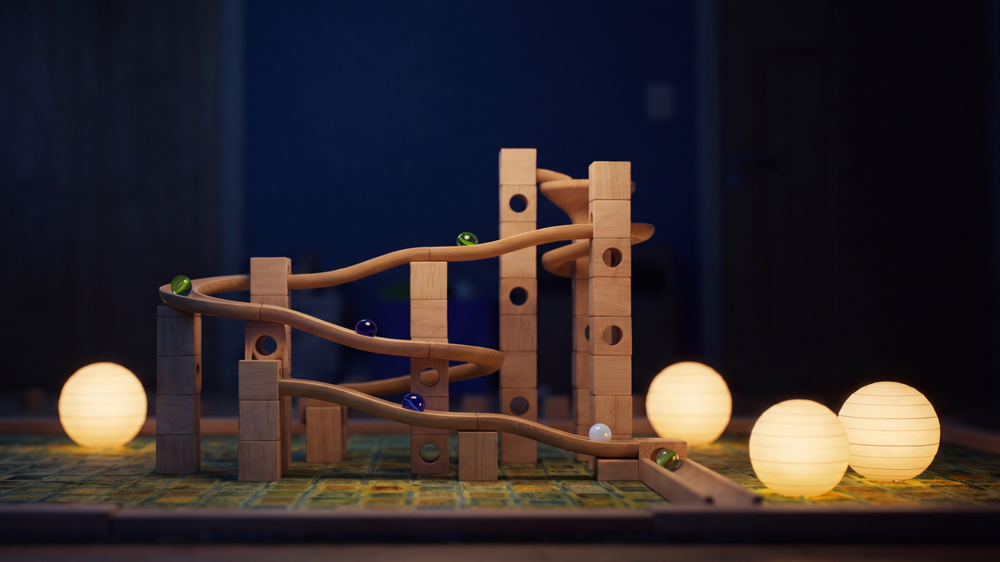
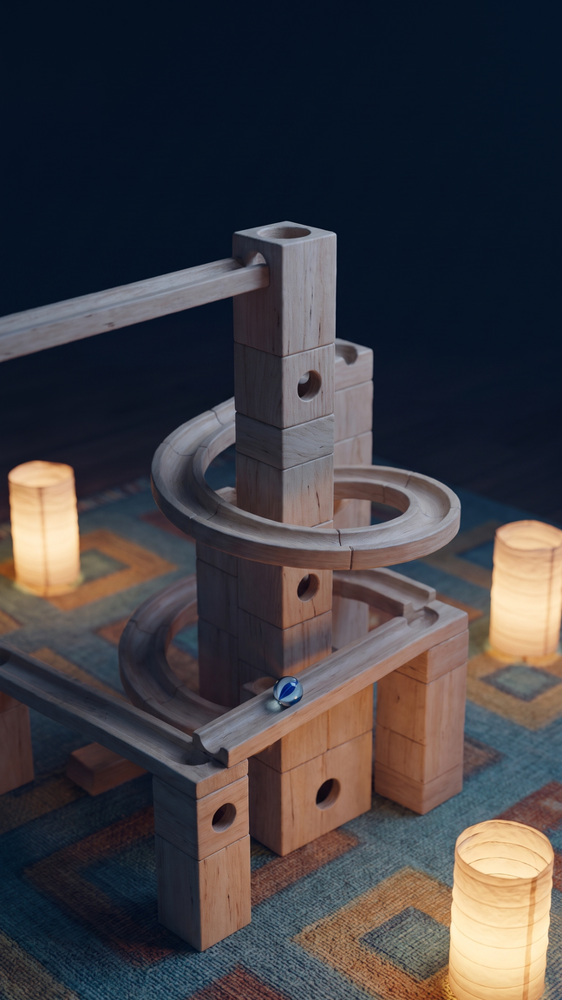
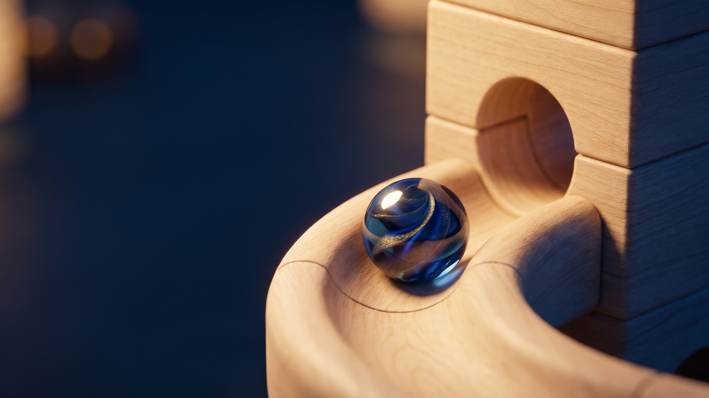
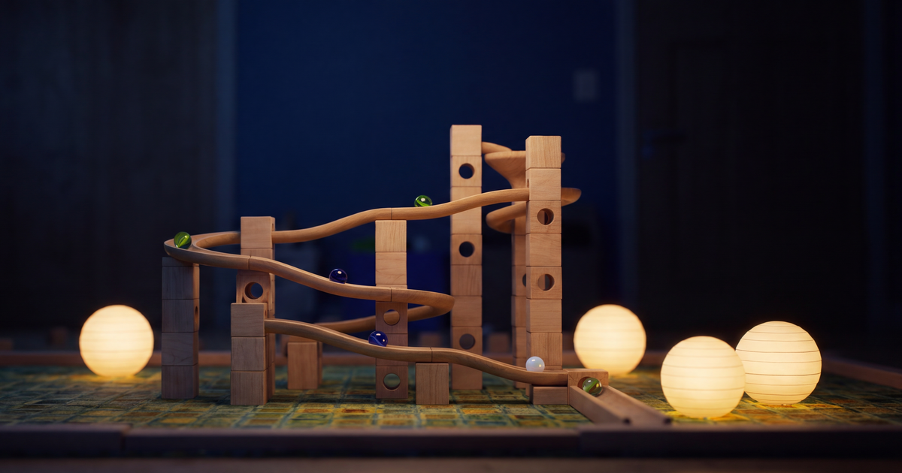

# Key art (P5-T2)

Title-screen hero, loading art and social card for parble, generated with Higgsfield `nano_banana_pro` on 2026-11-07. The images contain no text: the "parble" wordmark, menu and progress UI are overlaid by the game. Sources in this directory are stored exactly as the provider delivered them. Runtime derivatives live in [`assets/keyart/`](../../assets/keyart/) and are rebuilt by `python3 -I assets-source/keyart/derive.py`. Full records (prompts, job ids, reference hashes, crops, encoder settings, file hashes) are in [`provenance.json`](provenance.json), with the raw job receipts in [`receipts/`](receipts/) and the prompts in [`prompts/`](prompts/).

**Status: approved by Paul on 2026-11-08.** He approved the hero art and chose the primary wide hero (`hero-wide-21x9.png`) over the alternate. The alternate is kept as an unused source. Rights are cleared: Higgsfield's Terms of Use section 4.4 claim no ownership of outputs and do not restrict their commercial use.

## Sources

| Source | Role | Size | Prompt | References | Notes |
|---|---|---|---|---|---|
|  `hero-wide-21x9.png` | Wide hero, **primary** | 6336x2688 (4k, 21:9) | [hero.txt](prompts/hero.txt) | look-dev 04, 03, 02 | Compact tower track with wavy rails, a spiral, marbles mid-run, four paper lanterns, square-pattern rug. Open dark wall above for the title. Rails are open troughs, which matches the kit contract's rail family (`docs/kit-contract.md` §5.3: round trough, R14 half-round inner profile). A faint wall plate sits inside the 16:9 title zone at about x 0.65-0.68, y 0.15-0.21 (low luma, retouchable if wanted). |
|  `hero-wide-21x9-alt.png` | Wide hero, alternate | 6336x2688 (4k, 21:9) | [hero-alt.txt](prompts/hero-alt.txt) | look-dev 04, 03, 02 | Frontal, sparser layout with solid round dowel rails and a corkscrew; two lanterns. Solid dowels do not match the contract's trough rails (§5.3). The run spans 10-93% of the width, so a 16:9 crop would cut the outer towers. No derivatives built. |
|  `hero-portrait-9x16.png` | Portrait hero | 1536x2752 (2k, 9:16) | [portrait.txt](prompts/portrait.txt) | look-dev 04, 06, 03 | High three-quarter view of a block tower with a spiral rail and a cat's eye marble. Rails are troughs per §5.3. Lanterns are cylindrical paper lanterns. Top fifth is open darkness. |
|  `loading-16x9.png` | Loading art | 2752x1536 (2k, 16:9) | [loading.txt](prompts/loading.txt) | look-dev 01, 06, 07 | Macro blue-and-gold swirl marble on a curved rail entering a block port. The provider added a near-black letterbox band from row 1354 down; the derivatives crop above it. |

All references are owner-approved look-dev targets. Frames 05, 08, 09 and `ref-09` (glow inlays) were not used, and every prompt forbids glowing strips, LEDs and emissive inlays, lettered blocks, other toys, text and logos.

## Runtime derivatives and crop-safe zones

Zones are fractions of the derivative frame as `x0, y0 - x1, y1`. **Title** is kept free for the wordmark. **UI** is the band for buttons or the progress bar. Mean luma (0 = black, 1 = white) is measured on the derivative; every title zone is at or below 0.11, so a light wordmark reads without a scrim.

| Surface | Files | Crop from source | Title zone (luma) | UI zone (luma) |
|---|---|---|---|---|
|  Hero 21:9 | `hero-21x9-2560x1086` and `-1280x543` (`.avif`, `.webp`); PNG fallback `-1280x543.png` | full `hero-wide-21x9.png` | 0.30, 0.04 - 0.70, 0.22 (0.08) | 0.30, 0.86 - 0.70, 0.97 (0.21) |
|  Hero 16:9 | `hero-16x9-2560x1440` and `-1280x720` (`.avif`, `.webp`); PNG fallback `-1280x720.png` | 4779x2688 at x=1127 | 0.25, 0.04 - 0.75, 0.22 (0.08) | 0.25, 0.86 - 0.75, 0.97 (0.22) |
|  Hero portrait 9:16 | `hero-portrait-9x16-1080x1920` and `-720x1280` (`.avif`, `.webp`); PNG fallback `-648x1152.png` | 1536x2731 at y=10 | 0.10, 0.04 - 0.90, 0.20 (0.06) | 0.10, 0.88 - 0.90, 0.97 (0.36) |
|  Loading 16:9 | `loading-16x9-1920x1080` and `-1280x720` (`.avif`, `.webp`); PNG fallback `-1152x648.png` | 2389x1344 at x=363 | 0.04, 0.55 - 0.34, 0.78 (0.10) | 0.04, 0.86 - 0.34, 0.94 (0.09) |
|  Social card | `social-card-1200x630.png` (og:image) and `.jpg` | 5120x2688 at x=957 | 0.25, 0.04 - 0.75, 0.22 (0.08) | none |

Layout notes for P5-T3:

- Use the 21:9 hero at 2.2:1 and wider, the 16:9 hero from 2.2:1 down to about 1.3:1, and the portrait hero below that, with `object-fit: cover` anchored top-center so the title zone survives.
- The 16:9 hero's tower sits right of center. Anchor the wordmark at the title zone's center, not the frame's left third.
- The portrait UI band crosses a lit lantern and the tower's base (luma 0.36). Put buttons there on a dark translucent backing, or stack them in the lower-middle over the rug.
- The social card is text-free. If the og:image should carry the wordmark, composite it into the card's title zone during P5-T3, add that step to `derive.py` and register the file here. `derive.py` empties `assets/keyart/` before each rebuild, so a file added there by hand is deleted on the next run.
- Serve AVIF first, then WebP, with PNG as the fallback. The social card is PNG (JPEG alternate) because link-preview scrapers do not reliably read AVIF or WebP.
- AVIF 2560-wide heroes are 50-63 KB. PNG fallbacks exist at one size per surface (654-903 KB), sized to stay under the repo's 1000 KB `check-added-large-files` limit for paths outside `assets-source/`. The checker enforces that limit.

## Generation

- 4 generations, 4 kept, 0 rejected, under the 12-generation cap.
- 12 credits spent: the balance went from 968 to 956 (two 4k jobs at 4 credits and two 2k jobs at 2 credits, matching the `generate cost` quotes). Every receipt's `job_type` is `nano_banana_pro`.
- No seed is exposed by the provider, so the frames cannot be reproduced exactly from their prompts.

## Validation (validate-generated-assets)

- Inventory: 4 immutable sources plus job receipts, prompts, `derive.py`, 22 derivatives and `provenance.json`. No previews or overlays are stored in either directory.
- Provenance reconciliation: `node assets-source/keyart/check-provenance.mjs` recomputes every source and derivative hash and byte count, parses PNG, JPEG, WebP and AVIF headers for dimensions, checks each receipt's job id, model and prompt against the record, verifies reference hashes and that no glow-inlay reference was used, and checks crop bounds, no upscaling, aspect preservation, the exact 1200x630 social card, the 1000 KB file limit, title-zone luma at or below 0.2, and that no unregistered file exists in either directory. A negative test (a stray file in `assets/keyart/`) fails with exit 1.
- Reproducibility: rerunning `derive.py` rebuilt all 22 derivatives byte-identically (the working tree stayed clean). Encoders: ImageMagick (Lanczos), cwebp 1.6.0 q82 m6, avifenc 1.4.2 (aom 3.15.3) q60 s6 4:2:0, JPEG q88.
- Full decode: every derivative decodes completely with ImageMagick at its recorded size as 3-channel sRGB. Decoded RGBA memory is 3.0-14.7 MB per image (the 2560x1440 hero is the largest).
- Encode fidelity: PSNR against the PNG at the same size is 40.7-41.1 dB for the AVIF and WebP heroes and 41.4 dB for the JPEG social card. A 2.5x brightness stretch of the dark title area of the 2560x1440 AVIF shows no visible banding.
- Not run: consumer and live-use checks (title and loading screens on desktop and mobile, Chrome and Safari, load latency, fallback activation). Those screens do not exist yet and belong to P5-T3. Fallback and lifecycle injection tests do not apply until then.

## Gates

| Gate | Status |
|---|---|
| Technical (file level: provenance reconciliation, full decode, deterministic rebuild; see Validation) | pass for the files; consumer checks pending P5-T3 |
| Creative | approved by Paul 2026-11-08 (primary wide hero) |
| Rights | cleared 2026-11-08: Higgsfield Terms of Use section 4.4 (no ownership claim on outputs, no commercial-use restriction) |
| Owner | approved by Paul 2026-11-08 |
| Live use (title and loading screens in Chrome and Safari, desktop and mobile) | partly: the P5-T3 title shows the three hero crops in GPU Chromium at 2.4:1, 16:10 and 3:4 windows, and the unsupported page shows the loading art (`e2e/tests/title.spec.mjs`, [docs/design/title](../../docs/design/title/README.md)). Safari, mobile, load latency and fallback activation are not checked. No loading screen exists yet. |
