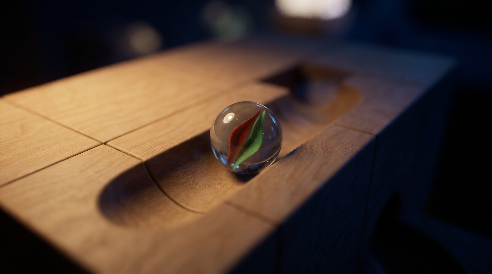
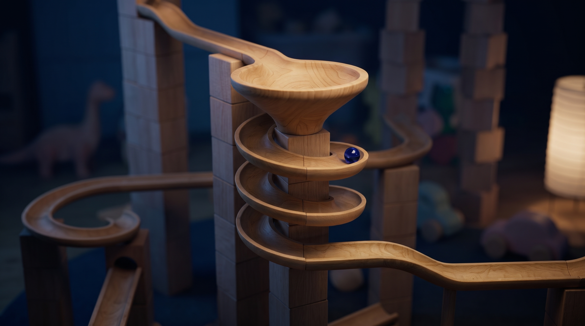
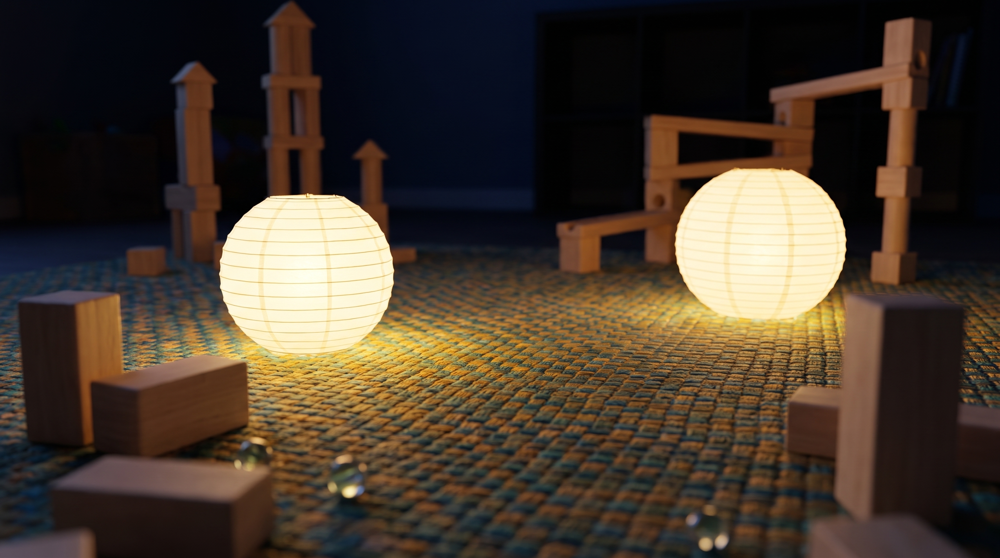
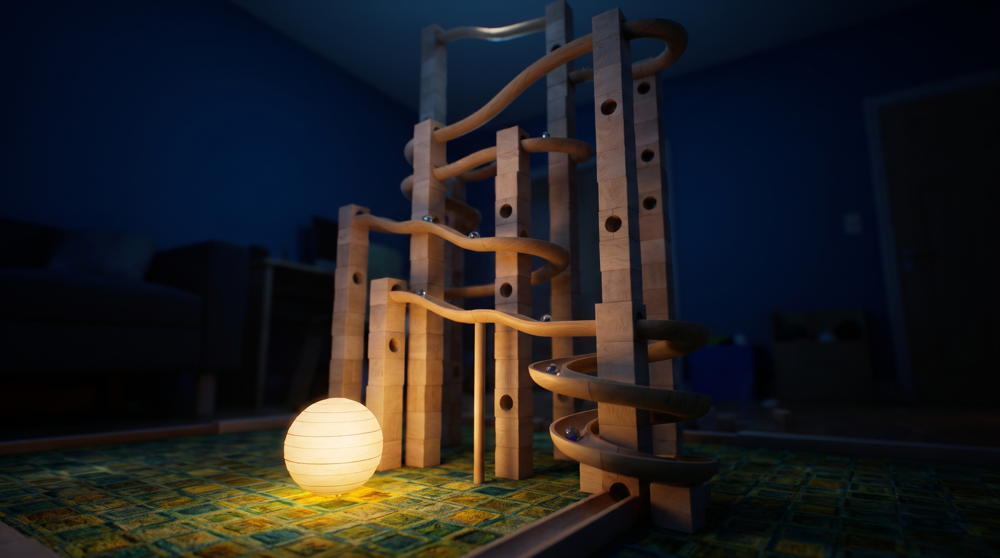
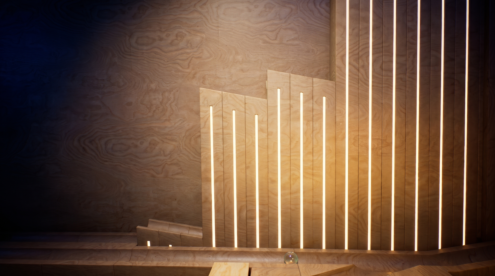
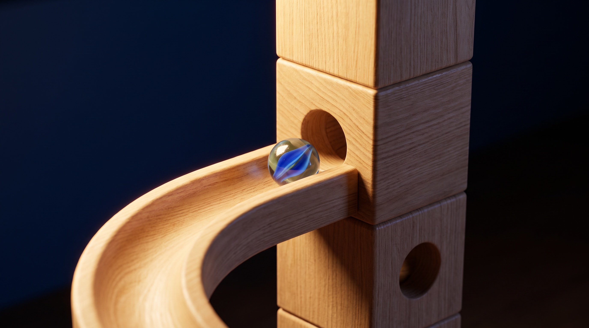
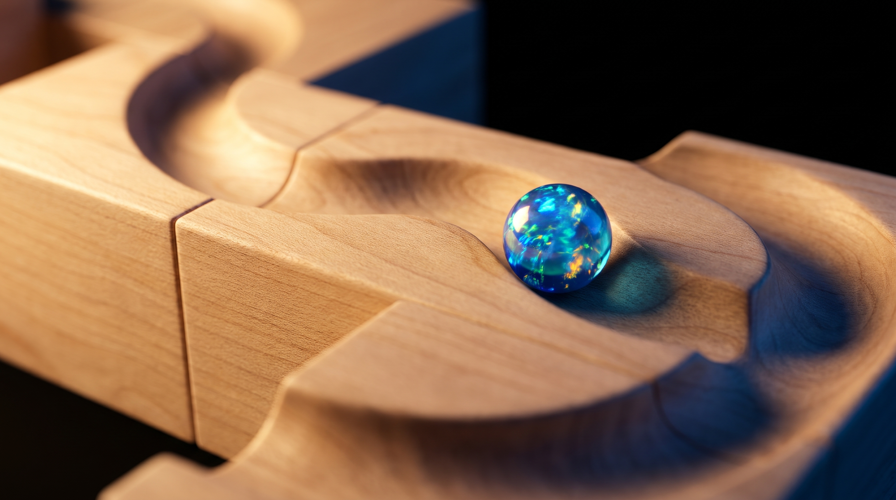
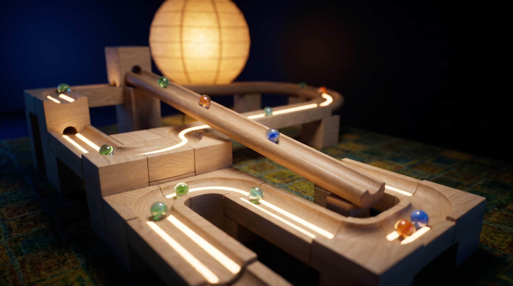
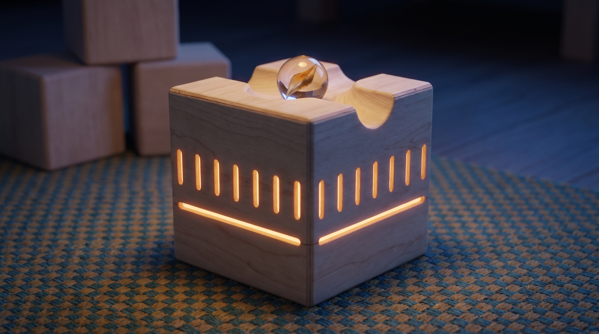

# Look-dev targets (P0-T9)

Concept frames for the parble night-playroom look, generated with Higgsfield `nano_banana_pro` (2k, 16:9, 2752x1536 PNG) on 2026-11-07. They are look-dev targets to compare renders against, not runtime assets. Each file is stored exactly as the provider delivered it. Full records (prompt, job id, reference hashes, file hashes) are in [`provenance.json`](provenance.json), and the prompts are in [`prompts/`](prompts/).

**Paul must pick the target set.** Mark the chosen frames (and any to drop or regenerate) before P1 look-dev uses them.

## Contact sheet

| # | Frame | Subject | Targets reference | Notes |
|---|---|---|---|---|
| 01 |  `01-macro-channel-cats-eye.png` | Macro block channel with a cat's eye marble | ref-02, ref-01 | Seams and grain read well. Background is warmer and brighter than the references. |
| 02 |  `02-corkscrew-funnel.png` | Corkscrew rail around a funnel | ref-05 | Strong match for the rail family and funnel. The background includes generic toys (dinosaur, plush). |
| 03 |  `03-playroom-rug-lanterns.png` | Night playroom rug with lanterns | ref-07, ref-08 | Two lanterns and scattered blocks. The rug reads as a woven weave, not ref-07's square pattern. |
| 04 |  `04-tower-track-wide.png` | Wide shot of a tall tower track | ref-06, ref-08, ref-05 | Tower with rails, a corkscrew, a lantern and a patterned rug. A good establishing target. |
| 05 |  `05-glow-inlay-panels.png` | Glow-inlay panels (close) | ref-09 | Follows ref-09's composition closely, so treat it as derivative of the reference. |
| 06 |  `06-rail-into-block-tower.png` | Rail entering a block-tower port | ref-06 | The rail is drawn as an open U-channel, not ref-06's round rail. Useful for the port and hole standard. |
| 07 |  `07-wave-channel-opal-marble.png` | Wave channel with an opal marble | ref-03, ref-01 | Opal marble and wave pieces (P7). Lighting is brighter than the references. |
| 08 |  `08-glow-inlay-track-wide.png` | Glow-inlay blocks in a track on the rug | ref-09, ref-07 | Inlay strips in track use, with a lantern and rug. Busy, with many marbles. |
| 09 |  `09-glow-inlay-block.png` | Single glow-inlay block on the rug | none (text only) | An original inlay pattern on one kit block. |

## Generation

- 9 generations, 9 kept, 0 rejected, under the 15-generation cap.
- 18 credits spent: the balance went from 986 to 968, with 9 "Nano Banana Pro -2" transactions.
- No seed is exposed by the provider, so frames cannot be reproduced exactly from the prompt.

## Gates

| Gate | Status |
|---|---|
| Technical (provenance reconciliation: `node assets-source/lookdev/check-provenance.mjs`) | pass |
| Creative | pending (owner review against `docs/reference/`) |
| Rights | pending. Frames were generated on Paul's Higgsfield plus plan, and commercial terms were not verified. The reference images have unknown ownership and were used only as style and lighting direction. Frame 05 is close to ref-09. |
| Owner | pending (Paul picks the target set) |
