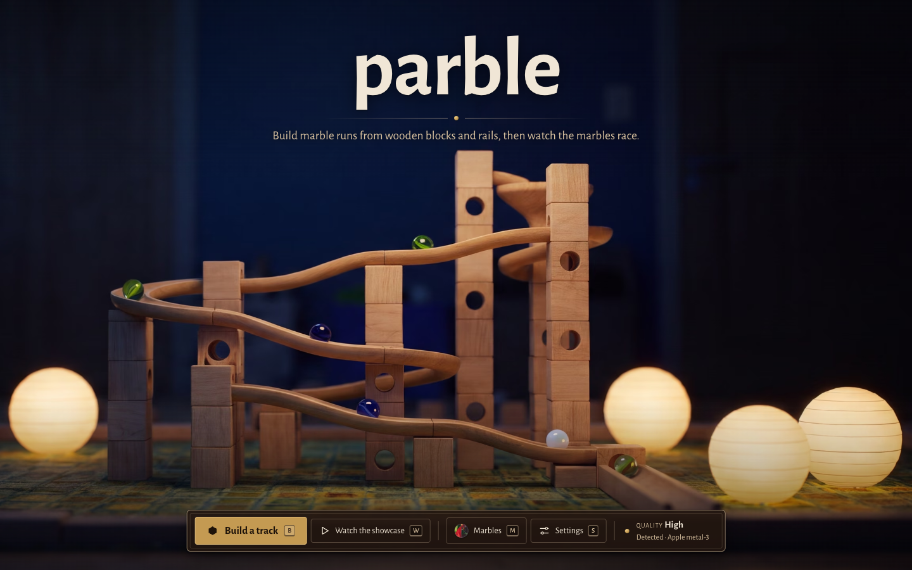
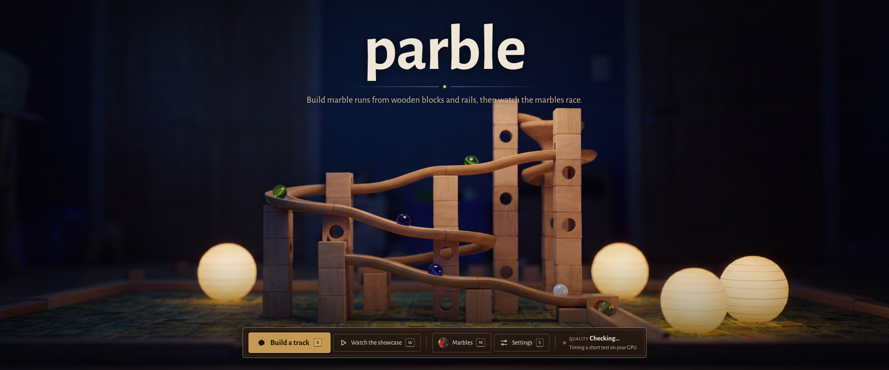
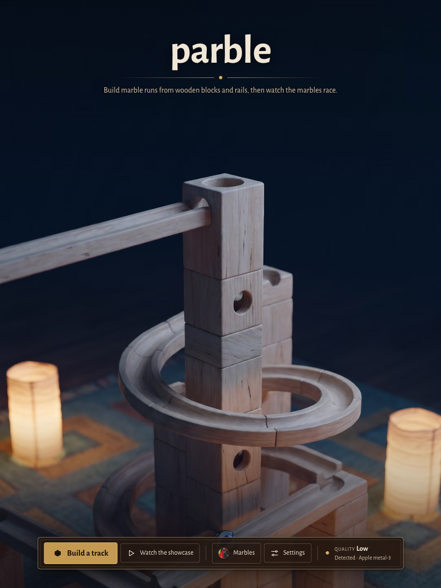
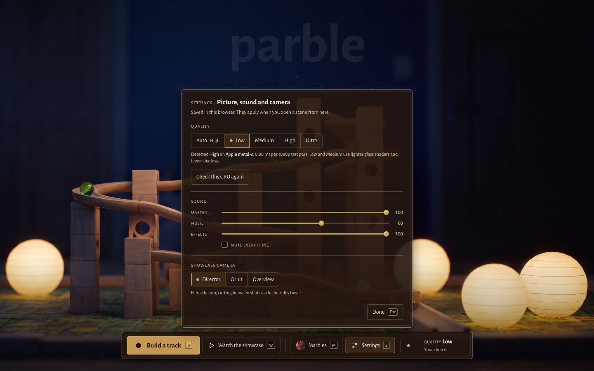
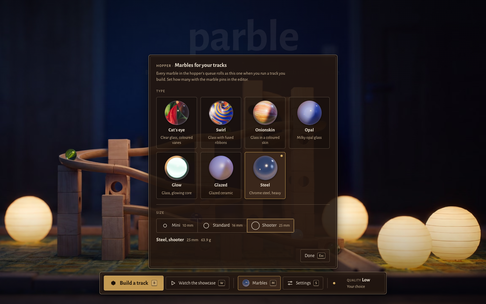
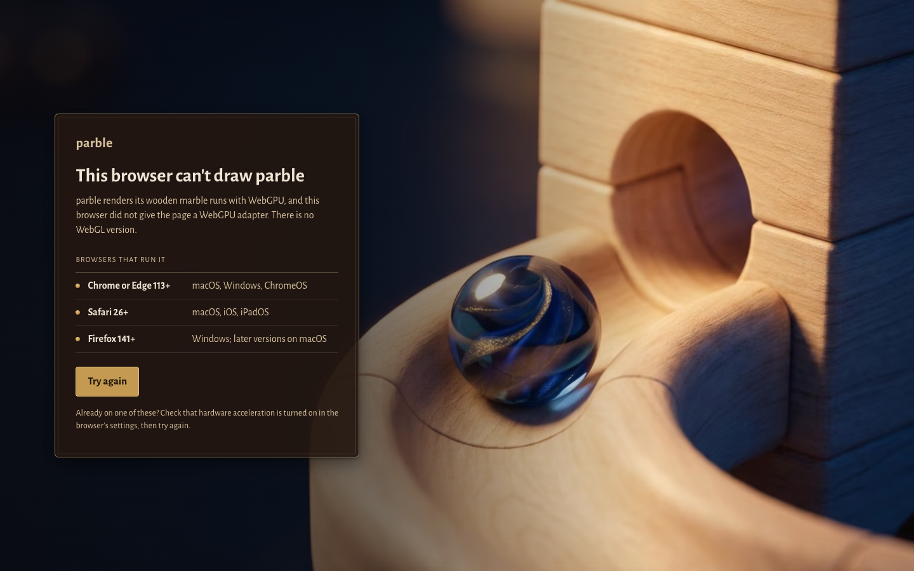

# Title screen, settings, marble picker and unsupported page (P5-T3)

**Status: pending Paul's review.** None of these visuals is approved yet: the title layout, the settings and marble sheets, the marble thumbnails, the unsupported page and the favicon.

The screens use the editor's Walnut Marquetry system ([DESIGN.md](../../../DESIGN.md)) rather than a new look: walnut-veil inlay panels with a 55% maple outer rule and a 16% inner stringing line, brass for the one primary action and every chosen state, pale blue for focus, and Alegreya Sans with small-caps labels and lining numerals. The key art is the approved primary wide hero (P5-T2, [assets-source/keyart](../../../assets-source/keyart/README.md)).

## Screenshots (GPU Chromium, 1440x900, from `e2e/tests/title.spec.mjs`)

| Screen | File |
|---|---|
| Title |  |
| Title, 2.4:1 window (21:9 hero; the readout shows the detection running) |  |
| Title, 3:4 window (portrait hero) |  |
| Settings |  |
| Marble picker |  |
| Unsupported browser |  |
| Favicon (512, 32 and 16 px, the last two scaled up) |  |

## What is on screen

- **Title.** The key art fills the screen with `object-fit: cover`, anchored top centre: the 21:9 hero at 2.2:1 and wider, the portrait hero at 1.3:1 and narrower, and the 16:9 hero between, AVIF then WebP with a PNG fallback. The "parble" wordmark and the tagline sit in the art's dark title zone, split by a maple rule with a brass pin. One inlay bar in the UI band holds Build a track (`B`, brass), Watch the showcase (`W`), Marbles (`M`, with the picked marble's swatch), Settings (`S`) and the quality readout. While the title shows, the music player holds the `title` cue.
- **Settings.** Quality (Auto, which follows the detection, or a fixed Low, Medium, High or Ultra) with the detection's adapter and test time, and a button to run the check again. Sound: the existing mixer's master, music and effects levels and mute, stored under the same `parble.mixer/1` key and applied live. Showcase camera: Director, Orbit or Overview.
- **Marble picker.** All seven types (docs/marbles.md) as tiles with a real render of each, and the three sizes with a scaled circle and the diameter. The line under the sizes gives the pick's mass from the physics table. Every marble in the hopper's queue runs as the pick; the editor's marble pins still set how many.
- **Unsupported page.** Static (its CSP allows no script). The P5-T2 loading art behind a darkening ramp, and one inlay panel with the three browser families, a brass Try again link and a hardware-acceleration hint.
- **Favicon.** A brass marble resting on a maple rail inside a walnut tile with the inner stringing line. Rendered from `web/favicon/favicon.svg` by `scripts/web/favicon.py` (the `favicon-generator` skill's cairosvg renderer) to 16, 32, 48, 180, 192 and 512 px PNGs and a 16+32+48 ICO. The skill's letter template ("P" on walnut) was tried first and dropped: a capital P did not match the lower-case wordmark and read as generic at 16 px.

## How it reaches the engine

The title is a front door. Build and Watch navigate to a scene URL (`?scenario=editor` or `?scenario=showcase`) with `quality=`, the marble pick (`marble=`, `marble-size=`) or the camera (`camera=`), so the engine reads them once at startup like any agent switch. A direct scene URL is never changed by stored settings. See `title=` in [agent-operability.md](../../agent-operability.md).

## First-run quality detection

`web/ui/src/title/gpu.ts` reads the adapter info, then times a 1920x1080 full-screen fragment test (48 trig iterations per pixel): one warm-up submit and five timed submits of four passes, each timed to queue completion. The median ms per pass picks the tier: at most 0.3 ms is Ultra, 2.5 ms High, 6 ms Medium, slower is Low, and a fallback (software) adapter is Low. A warm-up slower than 400 ms ends the check at Low. The result is stored in `parble.settings/1` and is not rerun until the player asks.

Calibration: an Apple M-series GPU (Apple, metal-3) in GPU Chromium measured 0.75 ms per pass with the 1-minute load average near 37, which is High, the tier the PRD sets for M-series. The thresholds leave room on both sides. They have not been checked on other GPUs.

## Marble thumbnails

`scripts/web/marble-thumbs.sh` captures each type with the native `closeup` scenario on High with DoF off, crops 204x204 around the resting marble and writes a 160 px WebP to `web/ui/thumbs/marbles/`. They are engine renders, so they have no outside provenance.
